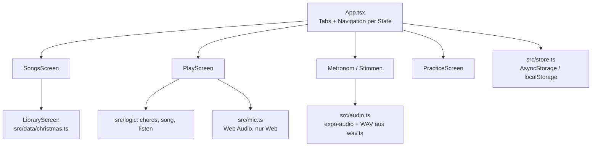
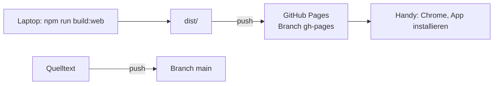

# 01 · Architektur

Expo SDK 58 / React Native 0.88, TypeScript strict. Eine Codebasis für Android/iOS (Expo Go) und Web (PWA). **Ausgeliefert wird derzeit nur die PWA** (ADR 025).

| Pfad | Inhalt |
|---|---|
| `src/logic/` | reine Logik ohne React Native, getestet (`logic.test.ts`, 15 Tests) |
| `src/ui/` | Screens, `ChordDiagram`, `theme.ts` (dunkles Thema) |
| `src/data/christmas.ts` | mitgelieferte Lieder (ChordPro) |
| `src/store.ts` | Lieder (`gitarren.songs.v1`) und Übungsprotokoll (`gitarren.log.v1`) — nur auf dem Gerät bzw. im Browser |
| `scripts/build-web.mjs` | `expo export` + Manifest + Service Worker + Icon |

## Auslieferung

- Pfad-Präfix `/gitarren-app` (`app.json` → `experiments.baseUrl`, ebenso in Manifest und Service Worker).
- Service Worker: network-first, Fallback Cache → Updates kommen beim nächsten Online-Öffnen.
- Zwei Kopien des Quelltexts: Arbeitsplatz-Repo `projects/gitarren-app/` und öffentliches Repo (Arbeitskopien im Scratchpad: `gitarren-repo` für `main`, `gitarren-repo-pages` für `gh-pages`; das Scratchpad kann verschwinden, dann frisch klonen). **Das Arbeitsplatz-Repo ist die Quelle**; das öffentliche Repo bekommt den Stand per `tar`-Kopie (ohne `node_modules`, `.claude`, `dist`, `.github`).
- Commits im öffentlichen Repo laufen über die GitHub-Noreply-Adresse (keine private Mail öffentlich).

## Preview

`.claude/launch.json` → `gitarren-app` (`npm start --prefix projects/gitarren-app -- --web --port 8099`).
