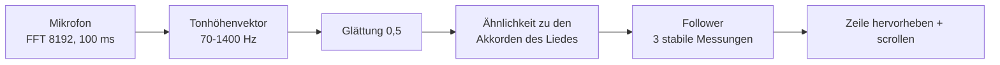
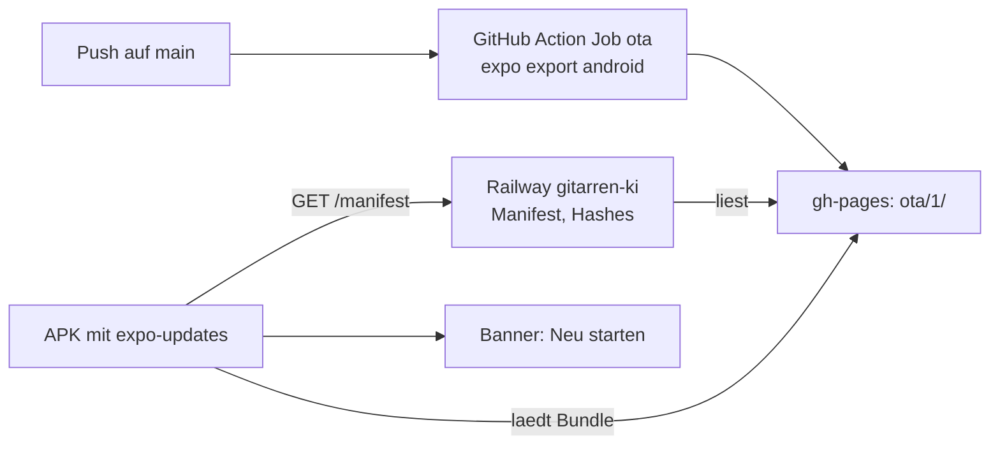

# 03 · Umsetzung und Logik

## Akkorde (`src/logic/chords.ts`)

- `parseChord`: Wurzel `[A-H][#b]?`; der Zusatz muss wie ein Akkordzusatz aussehen (`SUFFIX_RE`), sonst gelten „Dann" oder „Amen" als Akkord.
- **Deutsche Schreibweise:** `detectGerman` (irgendwo ein H) → H = B-Dur, B = Bb. Transponieren schreibt dann wieder H/B.
- `transposeChord(chord, steps, {flats, german})`; die Vorzeichenwahl trifft `PlayScreen` je Zielton (b bei 1, 3, 5, 8, 10).
- `SHAPES`: 27 Griffe (Saiten E A D G B e, −1 = stumm). `isEasy` = ohne Barré und höchstens Bund 3 (F, Bm, Bb, Fmaj7 gelten als Barré).
- `suggestCapo`: Bund 0–7 mit den meisten leichten Griffen nach dem Absenken.

## Lied-Parser (`src/logic/song.ts`)

Einheitliche Form `Line = {text, chords[{pos, chord}], section?}`.

- ChordPro, wenn `[A-H…]` im Text vorkommt (`{title:}`, `{soc}` usw. werden gelesen oder ignoriert).
- Sonst „Akkorde über Text": eine reine Akkordzeile plus die folgende Textzeile werden über die **Spaltenposition** verbunden; Abschnittsmarken (Strophe, Refrain, …) werden erkannt.
- `toSegments` schneidet den Text an den Akkordpositionen → Anzeige Akkord über der Silbe.

## Import (`src/logic/importer.ts`)

`extractFromHtml`: größtes `<pre>`, sonst Seitentext ohne script/style/nav/header/footer; Entities werden dekodiert.

## Zuhören (`src/logic/listen.ts`, `src/mic.ts`)

- Verglichen werden nur die Akkorde **dieses Liedes** (kleine Auswahl, robust). Schwellen: Ähnlichkeit ≥ 0,72, Abstand zum Zweitbesten ≥ 0,04, Pegel > 0,01.
- Vorlage je Akkord: Grundton 1,0, Terz und Quinte 0,8, Septime 0,5 (`chordTemplate`); tiefe Töne gewichtet `1/√(f/100)`.
- `Follower`: springt auf den **nächsten** Token mit dem erkannten Akkord (Reichweite 4; nach 12 erfolglosen Runden 14), nie rückwärts. Antippen einer Zeile = `setLine`.
- Web Audio mit `echoCancellation`, `noiseSuppression` und `autoGainControl` auf `false`. Nur über https (GitHub Pages erfüllt das).

## Metronom (`ToolsScreen.tsx`)

Selbstkorrigierender `setTimeout` (`next += 60000/bpm`), Klick = WAV mit 1500/1000 Hz, 40 ms; Taktart 2/3/4/6.

## Üben (`src/logic/practice.ts`)

`streak` (ein heute noch leerer Tag bricht nicht ab), `weekMinutes`, `suggestToday` (erst „üben", dann „neu", je der am längsten nicht gespielte zuerst).

## Stimmgerät (`src/logic/pitch.ts`, `src/ui/TunerScreen.tsx`, `startPitchMic` in `src/mic.ts`)

- Zeitfenster 4096 Samples alle 80 ms → `detectPitch` (YIN, Schwelle 0,15, parabolische Interpolation, 60–450 Hz, Pegel > 0,008 RMS) → `PitchSmoother` (Median über 5) → `nearestString` (nächste der 6 Saiten, Abweichung in Cent; Option „Halbton tiefer").
- Anzeige: Saitenname, Hz, Cent, Zeiger; grün bei ±5 Cent. Referenztöne bleiben als Ausweichlösung ohne Mikrofon.
- Tests: Sinus mit Obertönen trifft alle sechs Saiten auf < 2 Cent; Stille/Rauschen = kein Ton.

## Liedersuche (`src/logic/aiSearch.ts`, `src/ui/SearchScreen.tsx`)

- Eingabe per Text oder Sprache (`SpeechRecognition`, `de-DE`, nur Web in Chrome/Safari). Ablauf: erst `localSearch` im eingebauten Bestand (Titel/Autor/Text); ohne Treffer oder mit gesetztem Schlüssel `aiSearch`.
- `aiSearch`: `POST https://api.anthropic.com/v1/messages` direkt aus dem Browser (`anthropic-dangerous-direct-browser-access`), Modell `claude-haiku-5-5`, Schlüssel in `AsyncStorage` (`gitarren.apikey.v1`), nur auf dem Gerät. Antwort = JSON-Array (max. 3), `parseAiSongs` liest tolerant und verwirft Lieder ohne Akkord.
- **Urheberrecht:** Der Systemprompt verlangt Volltext nur bei gemeinfreien Liedern; bei geschützten nur Abschnitte + Akkordfolge (Song bekommt einen Hinweis im Body). Unsichere Lieder → leeres Array statt Erfindung.
- Bester neuer Treffer wird automatisch übernommen (`id = ki-<slug>`, `source: 'ki'`), weitere per Antippen.

## Natives Mikrofon und Sprache

- `src/mic.ts` wählt je Plattform: Web = `getUserMedia` + AnalyserNode; nativ = `startNativePcm` (`src/nativeMic.ts`, `react-native-audio-api` `AudioRecorder.onAudioReady`, 44,1 kHz mono) → Ringpuffer (4096 bzw. 8192 Samples) → `fftMagnitudes` (`src/logic/fft.ts`, Hann + Radix-2) → `chromaFromSpectrum`. Die Web-Fassungen `*.web.ts` sind Stubs, damit die native Bibliothek nicht ins Web-Bundle kommt.
- Spracheingabe nativ: `expo-speech-recognition` (`src/nativeSpeech.ts`, `de-DE`, ein Satz). Berechtigungen/Plugins in `app.json` (`RECORD_AUDIO`).

## Update-Hinweis (`src/update.ts`, `src/logic/updateCheck.ts`, `src/ui/UpdateBanner.tsx`)

- Web: `build-web.mjs` schreibt `dist/version.json` und `window.__BUILD__` in `index.html` (Zeitstempel). Die App vergleicht beim Start, bei Rückkehr in den Vordergrund und alle 30 min; bei Abweichung Banner „Aktualisieren" (= Seite neu laden, kein manuelles Leeren).
- APK: Workflow setzt `EXPO_PUBLIC_BUILD=${{ github.run_number }}`; die App fragt `releases/latest` von `ehret1684/gitarren-app` ab; höheres `build-N` → Banner mit Direktlink auf die APK. Ohne Build-Kennung (Entwicklung) keine Prüfung. Installieren muss man die APK weiterhin selbst (Android-Vorgabe).

## App-Symbol

`scripts/make-icons.py` (Pillow) zeichnet eine Gitarre und erzeugt alle Dateien in `assets/` (`icon`, `android-icon-foreground/-background/-monochrome`, `splash-icon`, `favicon`). Farben aus `theme.ts` (Akzent `#f2a03d` auf `#14110f`). Neu erzeugen: `python scripts/make-icons.py`, dann `npm run build:web`.

## KI-Vermittler (`ki-proxy/server.mjs`) — Stand: Quelltext fertig, **nicht ausgerollt**

Ein fest eingebauter Schlüssel wäre in der öffentlichen App und im öffentlichen Repo lesbar; deshalb hält ein kleiner Node-Dienst den Anthropic-Schlüssel (`ANTHROPIC_API_KEY`) und prüft einen Zugangscode (`APP_CODE`, Header `x-code`). Feste Modell- und Prompt-Vorgabe serverseitig, 300 Zeichen je Anfrage, `TAGESLIMIT` (150), fünf Fehlversuche je Absender = 15 min Sperre. Die App nimmt im Suchfeld entweder `sk-…` (direkt) oder den Zugangscode (über `PROXY_URL` in `aiSearch.ts`, derzeit leer). Der Prompt steht doppelt (App und Server) — bei Änderung beide anpassen.

## Over-the-air-Updates (APK)

- `app.json`: `runtimeVersion: "1"`, `updates.url` = `…/manifest` des Dienstes `gitarren-ki`; `checkAutomatically: ON_LOAD`, `fallbackToCacheTimeout: 0` (Start nie blockiert; bei Fehler läuft der eingebaute Stand).
- Der Dienst `ki-proxy/server.mjs` baut aus `ota/<runtime>/metadata.json` ein Manifest (Protokoll 1, multipart, SHA-256-Hashes der Dateien, `id` = Hash der metadata).
- `src/otaUpdate.ts`: `checkForUpdateAsync` → `fetchUpdateAsync` → Banner „Update geladen · Neu starten" (`reloadAsync`). Ohne OTA-Treffer prüft `checkUpdate` weiter auf eine neue APK.
- **`runtimeVersion` hochzählen**, sobald sich native Module/Plugins ändern (neue Bibliothek, `app.json`-Plugins): nur dann braucht es eine neue APK; reine JS-/Bildänderungen kommen per OTA. Eine APK mit alter Runtime ignoriert neuere Updates.
- **Beim manuellen Web-Deploy `ota/` auf `gh-pages` stehen lassen** (nicht mit löschen).

## Tabulatur-Ansicht (`src/logic/tab.ts`)

Knopf „Tab" im Liedmodus. `chordFrets` dreht die Griffe aus `SHAPES` (tief → hoch) auf Tabulaturreihenfolge (e, B, G, D, A, E; `x` = Saite nicht gespielt). `lineToTab` setzt jeden Akkord als Bundzahlen-Säule genau über die Silbe, auf der er steht; Transponieren und Kapo-Absenkung wirken mit (`map`). Zeilen ohne Akkord bleiben Text. **Grenze:** Es werden nur Akkordgriffe als Tab ausgegeben, keine Melodienoten — die Lieder enthalten keine Notendaten, und Melodien aus dem Gedächtnis zu setzen wäre unzuverlässig.
